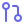

<div align="center">


# Gaia

**Drag your ideas into a workflow — or just tell the AI what you need**

Open-source visual AI workflow engine · Canvas editing × Chat-driven building × Runs locally

Built on [flowgram.ai](https://github.com/bytedance/flowgram.ai) · [MIT](./LICENSE)

[](https://github.com/boommanpro/gaia-workflow-engine/stargazers)
[](https://github.com/boommanpro/gaia-workflow-engine/releases)
[](./LICENSE)
[](https://boommanpro.github.io/gaia-workflow-engine/)

[简体中文](./README.md) · [Live Demo](https://boommanpro.github.io/gaia-workflow-engine/) · [Docs](https://boommanpro.github.io/gaia-workflow-engine/#docs) · [Release Log](https://boommanpro.github.io/gaia-workflow-engine/#/releases) · [Issues](https://github.com/boommanpro/gaia-workflow-engine/issues) · [Discussions](https://github.com/boommanpro/gaia-workflow-engine/discussions)

</div>

---

##  What Gaia does, in 76 seconds

Describe what you need in the sidebar chat and the AI plans the steps, creates the nodes and wires them up; hit run and the result appears right on the canvas. Recorded from real API calls:

https://github.com/user-attachments/assets/2530ba1e-3ac2-49c3-835f-87ed9f77b44c

<details>
<summary>Timeline</summary>

| Time | What happens |
|------|--------------|
| 0:00 | Canvas overview: Start → Condition → Copywriting → End |
| 0:18 | Sidebar chat: describe the task, the AI plans five steps |
| 0:46 | Auto orchestration: nodes created and wired, three unit tests pass (sped-up replay) |
| 0:55 | Trajectory: every tool call and execution step is traceable |
| 1:01 | Test run: input 85, the "pass" branch fires and returns the verdict |

</details>

##  Highlights

** Drag-and-drop orchestration**
An infinite canvas you can zoom, drag and connect. LLM calls, code execution, HTTP requests, branches, loops — the building blocks are all in the node panel.

** Describe it, and the AI builds it**
Don't feel like dragging? Describe what you need in the sidebar chat; the AI plans the steps, creates the nodes and wires them up — every move visible in real time, interruptible at any point.

** Test before you ship**
Run any node in isolation, or the whole flow with one click. Inputs, outputs, execution history and token usage are all visible live.

** Scheduled automation**
Set a cron expression or a simple rule and the workflow runs itself daily or hourly. Missed triggers can be configured to skip or catch up once, with full run history to look back on.

** Every save is a version**
Versions are recorded automatically. Diff any two and switch the active one with a click — change boldly, roll back anytime.

** Your data stays yours**
Single-file SQLite storage keeps everything on your own machine or server. You pick the model endpoint too (vLLM / Ollama / LM Studio / any OpenAI-compatible gateway).

** Your coding agent can build too**
Gaia ships a built-in MCP server: Claude Code, DeepSeek, Cherry Studio — any streamable-http agent can build workflows inside Gaia while you watch it work on the canvas.

##  Who is it for

| If you… | Gaia gives you… |
|---|---|
| Keep repeating "export data → feed it to the AI → reformat the output" | The whole pipeline on a canvas, re-runnable in one click |
| Want to build a small AI tool for your team | Canvas + config center — no frontend code required |
| Like cloud orchestration products but care about data privacy | Local SQLite, your own model endpoint, MIT-licensed and hackable |
| Play with coding agents and want their work to last | MCP integration: the agent builds, you approve, the workflow stays |

##  Quick Start

| Option | Best for | Time to start |
|---|---|---|
| [Live demo](https://boommanpro.github.io/gaia-workflow-engine/) | Zero-install browsing | 10 seconds |
| macOS desktop app | Everyday use on your own machine | ~5 min |
| Docker Compose | Servers, shared by a team | ~10 min |
| Run from source | Development | Needs JDK 21+ / Node 18+ |

> Whichever option you pick, the last step is the same: fill in an OpenAI-compatible endpoint (API Host / API Key / model name) under **Admin → Config → Model Settings** and save — it takes effect immediately, no restart. The default execution engine is the built-in AgentScope; you can switch to Volcengine Ark Managed Agents on the same page.

### macOS desktop app (easiest)

Frontend and backend packaged into one app — install and go:

```bash
cd apps/desktop
pnpm install
pnpm build:mac   # produces out/Gaia-<version>-mac-{arm64,x64}.dmg and .zip
```

Double-click the dmg and drag Gaia into Applications. The machine needs JDK 21+; for the unsigned build, right-click → Open on first launch, or run `xattr -cr /Applications/Gaia.app`. Data lives separately in `~/Library/Application Support/Gaia/data/`; after closing the window the app keeps running in the background (menu-bar icon brings it back, with optional launch-at-startup in the background). See [apps/desktop/README](./apps/desktop/README.md) for details.

### Docker Compose (recommended for servers)

```bash
cp .env.example .env
docker compose up --build -d
```

Open <http://localhost:8080> (health check at `/api/health`). Data is persisted in a named volume, so `docker compose down` keeps it.

<details>
<summary>Docker operations cheat sheet</summary>

```bash
docker compose ps                # status
docker compose logs -f web api   # logs
docker compose up --build -d     # rebuild after an update
docker compose down              # stop (data kept)
```

- The SQLite file is `/data/gaia_workflow.db` in the `api` container, persisted by a named volume; only run `docker compose down -v` when you are sure the data is no longer needed
- SQLite supports a single writer only — do not scale this stack to multiple API replicas writing to the same database
- If an externally hosted engine (e.g. AgentScope Service) must call back into Gaia, set `GAIA_MCP_PUBLIC_URL=https://your.public.domain` and route `/mcp/` (plus `/api/` for the UI) to this stack's web service; leave it empty for local runs with the built-in agent
- Troubleshooting: for 502s check `docker compose ps` for a healthy api; for SSE dropouts make sure the upstream proxy does not buffer; for SQLite permission errors do not change the ownership of `/data` (the image writes as a non-root user)

</details>

### Run from source (development)

<details>
<summary>Expand</summary>

Requirements: Node.js ≥ 18 · JDK ≥ 21 (runtime) · Maven 3.x

```bash
# Frontend (port 3000)
cd apps/console
npm install
npm run dev

# Backend (port 48080) — on a fresh clone, install the base/infra artifacts locally first
cd apps/api/gaia-workflow
mvn install -DskipTests
cd gaia-workflow-app
mvn spring-boot:run
```

The SQLite database `gaia_workflow.db` is created in the process working directory; first startup initializes the schema and seeds default configuration. The project builds for Java 17, but code nodes are compiled at runtime with `-source 21`, so the **runtime** requires JDK 21+.

For production, package an executable jar:

```bash
cd apps/api/gaia-workflow
mvn package -DskipTests
java -jar gaia-workflow-app/target/gaia-workflow-app-0.0.1-SNAPSHOT.jar
```

</details>

##  Feature Overview

**Canvas**
- Infinite zoomable canvas with minimap, auto-layout, snap lines and more
- Nodes: LLM call · code execution · HTTP request · string formatting · variable management · multi-branch conditions (and/or groups + else fallback) · loops
- Per-node unit tests plus full-workflow runs, with live input/output and execution history

**AI building**
- Sidebar chat: CreatePlan step-by-step planning, Canvas tool creates nodes and edges
- Run HTTP / Query lookups right in the conversation; live token usage and plan progress
- Every tool call is fully traceable via Trajectory; sessions are renameable

**Configuration & operations**
- Agent config center: model parameters, system prompt, knowledge base, tool definitions
- Switchable execution engine: built-in AgentScope, or Volcengine Ark Managed Agents
- One-click workflow templates; Scheduled Task Center: cron / simple mode, missed-trigger policy (skip / catch up once), run history with scheduled-trigger markers
- Observability API (`/api/agent/metrics/*`): tool calls, session runs, LLM call ledger and context usage stats

##  Let external agents build for you

Gaia exposes an MCP control plane with session keys built into the URL. Any streamable-http MCP client works; the session key is yours to choose (an "external build" session is created automatically on first connect):

```
http://127.0.0.1:48080/mcp/gaia/my-first-session
```

- **Watch it live**: while the agent builds, open the session with the same key in the console (`/chat/<session-key>`); the canvas renders incrementally with every tool call, and the agent's `ask_user` questions are answered right on the page
- **Same toolset** as the built-in agent: look up node contracts, build incrementally, run tests, manage test cases
- **You own the save**: the agent only produces a session draft — turning it into a version is your call. The AI does the work, you make the final cut
- **Optional auth**: set the `GAIA_API_KEY` environment variable (comma-separated for multiple keys) and `/mcp/gaia/**` requires a matching `X-API-Key` header; without it, requests are allowed (trust mode for local single-machine setups)

<details>
<summary>curl examples (MCP is plain HTTP POST + JSON)</summary>

```bash
# initialize (returns viewing guidance and creates the session)
curl -s -X POST http://127.0.0.1:48080/mcp/gaia/ext-deepseek-01 \
  -H 'Content-Type: application/json' \
  -d '{"jsonrpc":"2.0","id":1,"method":"initialize","params":{"protocolVersion":"2025-03-26","clientInfo":{"name":"DeepSeek Coder"}}}'

# add a start node (SSE /api/agent/session/ext-deepseek-01/events streams tool_call/document events live)
curl -s -X POST http://127.0.0.1:48080/mcp/gaia/ext-deepseek-01 \
  -H 'Content-Type: application/json' \
  -d '{"jsonrpc":"2.0","id":2,"method":"tools/call","params":{"name":"node","arguments":{"action":"add","type":"start"}}}'
```

</details>

##  Tech Stack

| Layer | Technology |
|------|------|
| Frontend | React 18 · TypeScript · [flowgram.ai](https://flowgram.ai/guide/) 1.0.12 |
| Backend | Spring Boot · MyBatis Plus · Java 17 (build) / 21 (runtime) |
| Storage | Single-file SQLite |
| Delivery | Single jar · Docker Compose · macOS desktop app · GitHub Pages frontend |

##  Documentation

- Project docs: <https://boommanpro.github.io/gaia-workflow-engine/#docs>
- flowgram.ai framework docs: <https://flowgram.ai/guide/>

##  Contributing

Issues and PRs are welcome. Commit messages follow [Conventional Commits](https://www.conventionalcommits.org/):

1. Fork the repo and create a feature branch
2. Commit your changes and open a Pull Request

##  License

[MIT](./LICENSE)

##  Star History

<a href="https://www.star-history.com/?repos=boommanpro%2Fgaia-workflow-engine&type=date&legend=top-left">
 <picture>
   <source media="(prefers-color-scheme: dark)" srcset="https://api.star-history.com/chart?repos=boommanpro/gaia-workflow-engine&type=date&theme=dark&legend=top-left" />
   <source media="(prefers-color-scheme: light)" srcset="https://api.star-history.com/chart?repos=boommanpro/gaia-workflow-engine&type=date&legend=top-left" />
   
 </picture>
</a>
