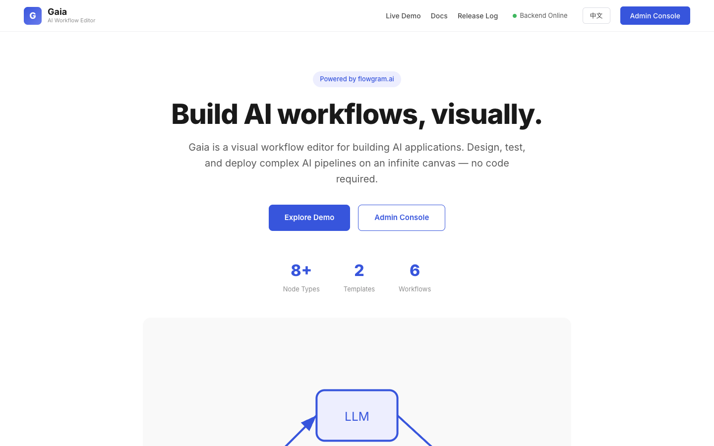
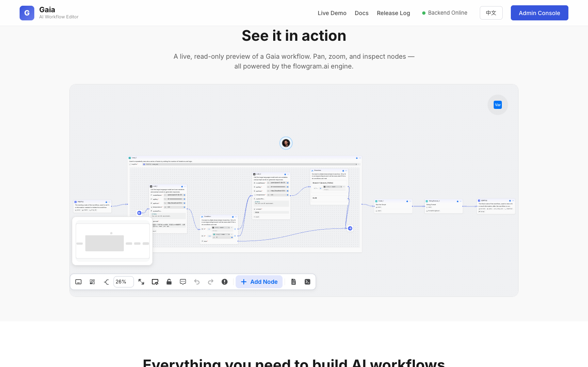
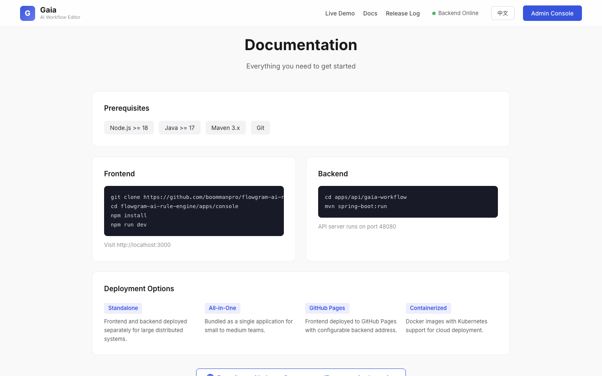
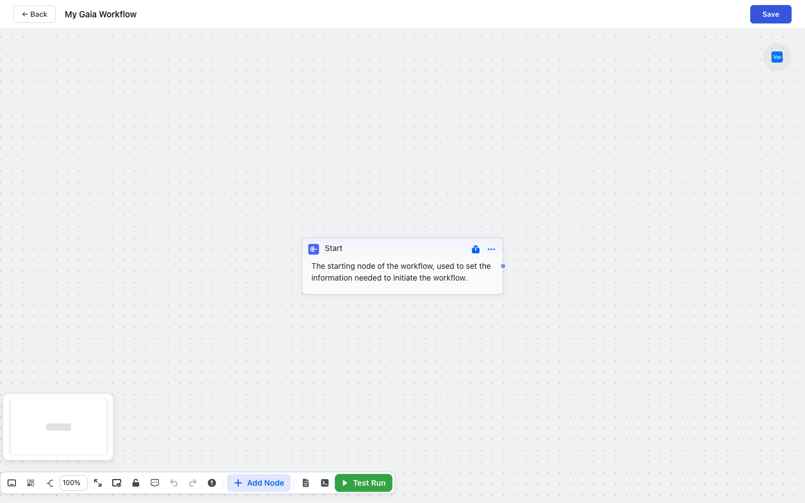
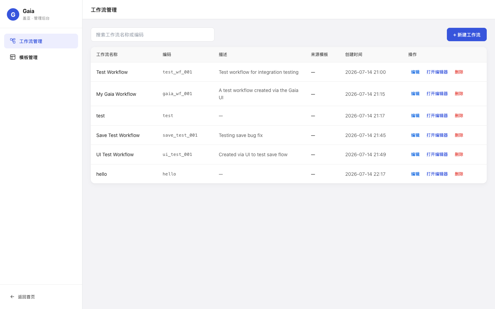
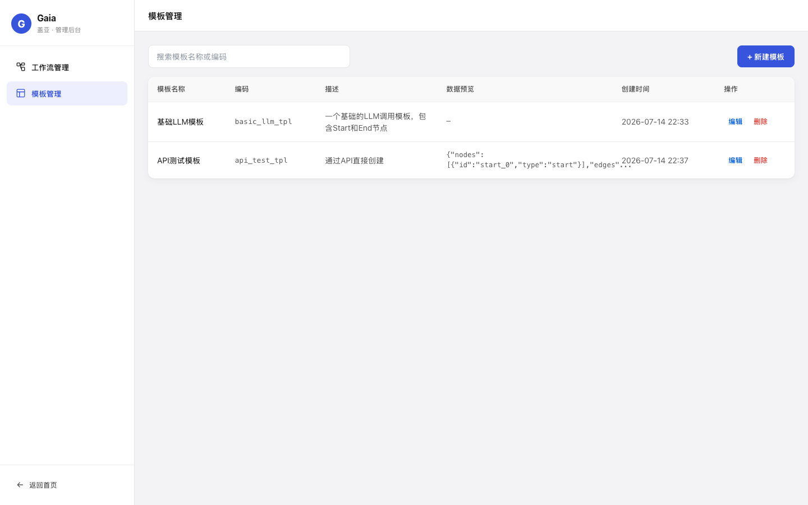
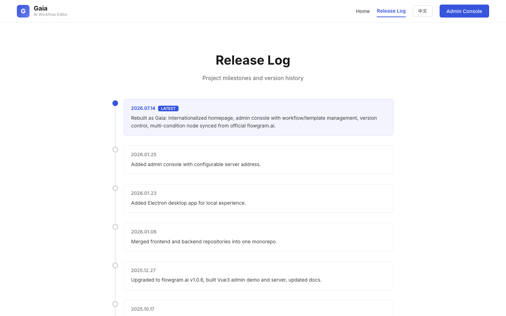

<div align="center">


# Gaia · Visual AI Workflow Editor

**Build AI workflows, visually. Powered by [flowgram.ai](https://github.com/bytedance/flowgram.ai).**

[](https://github.com/boommanpro/gaia-workflow-engine/stargazers)
[](https://opensource.org/licenses/MIT)
[](https://github.com/boommanpro/gaia-workflow-engine/releases)
[](https://boommanpro.github.io/gaia-workflow-engine/)

**[English](./README.en.md)** · **[简体中文](./README.md)**

</div>

---

A modern visual rule engine platform for orchestrating complex AI workflows. Design, test, and deploy AI pipelines on an infinite canvas — no code required. Combines the power of [flowgram.ai](https://flowgram.ai) with a Java backend for production-ready workflow management.

## Features

- **AI Agent Sidebar** — Conversational workflow generation: CreatePlan step-by-step planning, Canvas auto-create nodes & edges, HTTP/Query workflow lookup, live token & plan progress; sessions are renameable and reviewable.
- **Agent Config Center** — Model settings (Host/Key/Temperature/Max Tokens), default engine switching (built-in AgentScope / Volcengine Ark managed), system prompt & knowledge base, tool definition catalog.
- **Session Review & Tracing** — TraceView showing thinking, tool calls and LLM call logs (`agent_llm_call_log` observability table); replay sessions from recorded trajectories.
- **Visual Canvas** — Infinite, zoomable canvas with drag-and-drop nodes. Supports loops, branches, and conditional logic.
- **AI Node Types** — Built-in LLM calls, code execution, HTTP requests, string formatting, and variable management.
- **Real-time Preview** — Test individual nodes or entire workflows with live input/output inspection.
- **Version Management** — Every save creates a version. Switch, track, and roll back with one click.
- **Template System** — Create reusable workflow templates. Spin up new workflows in a single click.
- **Extensible Plugins** — Minimap, auto-layout, snap lines, node panel, and more.
- **Multi-condition Node** — Synced from official flowgram.ai for complex branching logic.

## Screenshots

### Workbench & Workflows

| Page | Preview |
|------|---------|
| **Home** — Internationalized product landing page |  |
| **Live Demo** — Interactive workflow canvas (draggable, add nodes, no run) |  |
| **Docs** — Quick start, prerequisites, deployment options |  |
| **Editor** — Visual workflow editor with version management |  |
| **Admin · Workflows** — Workflow management console |  |
| **Admin · Templates** — Template management console |  |
| **Release Log** — Version history timeline |  |

### AI Agent

| Page | Preview |
|------|---------|
| **AI Agent Chat** — Sidebar conversational workflow generation with CreatePlan + step cards |  |
| **Debug Panel** — Raw request/response, SSE event stream, context, Raw JSON; click messages to jump |  |
| **Agent Config · Models** — API Host/Key, model params, BGE Embedding vector search |  |
| **Agent Config · Prompts** — Default system prompt + tool definitions (navigate/query/manage/canvas) |  |
| **Agent Running Workflow** — Auto-creates nodes & edges on canvas, tests and executes step-by-step |  |

## Quick Start

### Prerequisites

| Requirement | Version |
|-------------|---------|
| Node.js     | >= 18   |
| Java        | >= 21 (runtime compile for code nodes) |
| Maven       | 3.x     |
| Git         | any     |

### Frontend

```bash
git clone https://github.com/boommanpro/gaia-workflow-engine.git
cd gaia-workflow-engine/apps/console
npm install
npm run dev
```

Visit http://localhost:3000

### Backend

```bash
cd apps/api/gaia-workflow
mvn install -DskipTests     # required on fresh clone: installs base/infra artifacts locally
cd gaia-workflow-app
mvn spring-boot:run         # dev mode, port 48080
```

> Multi-module note: running `gaia-workflow-app` alone resolves base/infra `SNAPSHOT` artifacts from the local Maven repository. After cloning (or whenever base/infra change), run `mvn install -DskipTests` from the aggregator directory `apps/api/gaia-workflow` first.

For production, package an executable jar:

```bash
cd apps/api/gaia-workflow
mvn package -DskipTests
java -jar gaia-workflow-app/target/gaia-workflow-app-0.0.1-SNAPSHOT.jar
```

The API server runs on port 48080. The SQLite database file `gaia_workflow.db` is created in the **process working directory**; first startup initializes schema and seeds default configuration automatically.

### LLM Configuration (required)

Agent chat requires an OpenAI-compatible LLM endpoint (vLLM / Ollama / LM Studio / any gateway). After startup, open **Admin → Config → Model Settings** in the browser, fill in API Host / API Key / model name and save — the config is stored in the `agent_config` table and takes effect immediately without restart.

- The default engine is the built-in **AgentScope** (Harness ReAct loop; depends on [io.agentscope:agentscope-harness](https://central.sonatype.com/artifact/io.agentscope/agentscope-harness), publicly available on Maven Central).
- Alternatively switch to the Volcengine Ark Managed Agents engine: fill in apiKey / environmentId / model ID in the "Ark Managed" section of the Model Settings page, then flip the default engine to Ark.

### Docker Compose deployment

Prerequisite: Docker Engine with Docker Compose v2. Copy the non-secret example configuration, then build and start the stack:

```bash
cp .env.example .env
docker compose up --build -d
```

On Windows PowerShell, use `Copy-Item .env.example .env`. Open <http://localhost:8080>; the health endpoint is <http://localhost:8080/api/health>. Only the Nginx `web` service publishes a host port. `api:48080` is reachable only on the Compose network. After the first start, configure an OpenAI-compatible model endpoint, model name, and API key in **Admin → Config → Model Settings**. Do not place those credentials in `.env.example` or commit them.

Useful operations:

```bash
# Status and logs
docker compose ps
docker compose logs -f web api

# Stop while retaining the named SQLite volume
docker compose down

# Rebuild after a source or image update
docker compose up --build -d

# Delete all local SQLite data only when that is intentional
docker compose down -v
```

The SQLite file is `/data/gaia_workflow.db` in the `api` container and is persisted by the named `gaia_data` volume. A normal `docker compose down` does not remove it; after recreating containers, verify it with `docker compose exec api ls -l /data/gaia_workflow.db`. SQLite supports one API writer only: do not horizontally scale this Compose deployment to multiple API instances that write to the same database.

The Docker frontend image injects same-origin `/api` at build time without changing the existing backend-address default for standalone or desktop deployments. Nginx preserves the `/api/` prefix and proxies API/SSE traffic with HTTP/1.1, buffering and caching disabled, so no permissive CORS policy is required. It also forwards `/mcp/` for managed-Agent callbacks and falls back to `index.html` for SPA routes.

#### Built-in vs. managed Agents

Local Compose supports the built-in Agent path by default; it does not make a managed Agent work out of the box. `host.docker.internal:48080` is not a production callback address and is not the default. If an externally hosted execution engine (such as AgentScope Service) must call Gaia's MCP endpoint, the deployer must supply a publicly reachable HTTPS base URL:

```dotenv
GAIA_MCP_PUBLIC_URL=https://gaia.example.com
```

The public reverse proxy or ingress must route `/mcp/` (and `/api/` for the UI) at that address to this stack's Nginx `web` service. Leave the value empty when Compose is local and only the built-in Agent is used. If a managed-Agent provider configuration has already been saved in the admin UI, its `mcpPublicUrl` overrides the application setting and must be updated to the same HTTPS address.

Troubleshooting:

- **Frontend 502:** run `docker compose ps`, wait for `api` to become `healthy`, then inspect `docker compose logs api` for startup or migration errors.
- **SSE disconnects:** use the Nginx `web` entrypoint and ensure any upstream proxy does not buffer responses or impose a short read timeout. The supplied `/api/` proxy disables buffering and uses a one-hour timeout.
- **SQLite permission errors:** do not replace the ownership of mounted `/data`; inspect it with `docker compose exec api ls -ld /data`. The image runs as the non-root `gaia` user.
- **Missing model configuration:** save the OpenAI-compatible endpoint, model name, and API key in Admin model settings. They are persisted in SQLite and must not be added to the image or example environment file.

## Tech Stack

| Layer       | Technology                                      |
|-------------|-------------------------------------------------|
| Frontend    | React 18, TypeScript, flowgram.ai 1.0.12       |
| Backend     | Spring Boot, MyBatis Plus, Java 17              |
| Database    | SQLite                                          |
| Build       | rsbuild (frontend), Maven (backend)             |

## Deployment Options

1. **Standalone** — Frontend and backend deployed separately for large distributed systems.
2. **All-in-One** — Bundled as a single application for small to medium teams.
3. **GitHub Pages** — Frontend deployed to GitHub Pages with configurable backend address.
4. **Containerized** — Official Docker Compose deployment with an Nginx frontend and Spring Boot API.

## Documentation

Full documentation is available on the [homepage Docs section](https://boommanpro.github.io/gaia-workflow-engine/#docs).

For flowgram.ai framework docs, visit https://flowgram.ai/guide/

## Release Log

See the [Release Log page](https://boommanpro.github.io/gaia-workflow-engine/#/releases) for the full milestone history.

## Contributing

1. Fork this project
2. Create a feature branch (`git checkout -b feature/AmazingFeature`)
3. Commit your changes (`git commit -m 'Add some AmazingFeature'`)
4. Push to the branch (`git push origin feature/AmazingFeature`)
5. Open a Pull Request

We follow [Conventional Commits](https://www.conventionalcommits.org/).

## License

This project is licensed under the MIT License — see the [LICENSE](./LICENSE) file for details.

## Star History

<a href="https://www.star-history.com/?repos=boommanpro%2Fgaia-workflow-engine&type=date&legend=top-left">
 <picture>
   <source media="(prefers-color-scheme: dark)" srcset="https://api.star-history.com/chart?repos=boommanpro/gaia-workflow-engine&type=date&theme=dark&legend=top-left" />
   <source media="(prefers-color-scheme: light)" srcset="https://api.star-history.com/chart?repos=boommanpro/gaia-workflow-engine&type=date&legend=top-left" />
   
 </picture>
</a>

---

<div align="center">

**[Live Demo](https://boommanpro.github.io/gaia-workflow-engine/)** · **[Admin Console](https://boommanpro.github.io/gaia-workflow-engine/#/admin/workflows)** · **[Release Log](https://boommanpro.github.io/gaia-workflow-engine/#/releases)** · **[Issues](https://github.com/boommanpro/gaia-workflow-engine/issues)** · **[Discussions](https://github.com/boommanpro/gaia-workflow-engine/discussions)**

</div>
